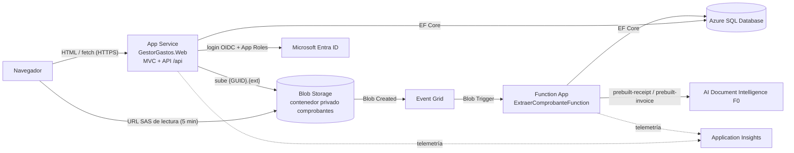

# GestorGastos: reembolsos de gastos con Azure

Trabajo práctico de Programación Web 3 (UNLaM). Los empleados cargan recibos y facturas; el archivo se guarda en
Azure Blob Storage y una Azure Function extrae comercio, fecha, descripción y monto con Azure AI Document Intelligence.
Un administrador toma cada comprobante en revisión, lo aprueba o lo rechaza y lo marca como pagado. El login es con
Microsoft Entra ID y los permisos salen de los App Roles `Empleado` y `Administrador`.

- Enunciado: [`docs/enunciado.md`](docs/enunciado.md). Prototipo: [`docs/prototipos.html`](docs/prototipos.html).
- Guía detallada de configuración y despliegue del equipo: [`SETUP.md`](SETUP.md).

## Arquitectura



Flujo de una carga: la web valida el archivo (extensión, contenido por magic bytes y 4 MB como máximo), crea el registro en
**Procesando** y sube el blob. Event Grid dispara la Function, que analiza el documento y deja el comprobante en
**Pendiente de Revisión**, o en **Error de extracción** si no detectó el monto o la descripción. La vista consulta el estado
cada 3 segundos hasta que cambia.

| Proyecto | Contenido |
|---|---|
| `GestorGastos.Web` | ASP.NET Core MVC (vistas Razor) y controllers de API bajo `/api` en el mismo proyecto |
| `GestorGastos.Functions` | Azure Function (isolated worker) con el Blob Trigger de extracción |
| `GestorGastos.Servicios` | Lógica de negocio compartida por la web y la Function: estados, validaciones, Blob Storage, Document Intelligence |
| `GestorGastos.Repositorios` | Acceso a datos con EF Core |
| `GestorGastos.Entidades` | Entidades, `DbContext` y migraciones (Code First) |
| `GestorGastos.DTOs` | DTOs, enums, validaciones y helpers de formato |

Stack: .NET 10, EF Core 10 + SQL Server, `Microsoft.Identity.Web`, `Azure.Storage.Blobs`, `Azure.AI.DocumentIntelligence`,
Application Insights y Bootstrap 5.3.

## Recursos de Azure

Grupo de recursos `rg-gestorgastos` (Canada Central):

| Recurso | Nombre | Plan / uso |
|---|---|---|
| App Service | `app-gestorgastos-pw3` (plan `asp-gestorgastos`) | F1. Web MVC + API |
| Function App | `func-gestorgastos-pw3` | Flex Consumption. Extracción de datos |
| Azure SQL Database | `sql-gestorgastos-pw3` / `GestorGastos` | Oferta gratuita |
| Storage account | `stgestorgastospw3` | Contenedor privado `comprobantes` + suscripción de Event Grid *Blob Created* |
| AI Document Intelligence | `di-gestorgastos-pw3` | F0 (4 MB y 2 páginas por documento como máximo) |
| Application Insights | `appi-gestorgastos` | Compartido por la web y la Function |
| App Registration | `GestorGastos` (tenant propio del equipo) | Login single-tenant con App Roles |

## App Registration y App Roles

En el tenant de Entra ID del equipo:

1. **App registrations → New registration**: nombre `GestorGastos`, *Accounts in this organizational directory only*
   (single-tenant).
2. **Authentication → Add a platform → Web**. Redirect URIs:
   - `https://localhost:7282/signin-oidc` y `https://localhost:7282/signout-callback-oidc` (desarrollo).
   - `https://<dominio del App Service>/signin-oidc` y `https://<dominio del App Service>/signout-callback-oidc`.

   Tildar **ID tokens** en *Implicit grant and hybrid flows*.
3. **Certificates & secrets → New client secret**: el *Value* va en `AzureAd:ClientSecret`.
4. **App roles → Create app role** (dos veces). *Allowed member types*: Users/Groups.

   | Display name | Value | Descripción |
   |---|---|---|
   | Empleado | `Empleado` | Carga y gestiona sus comprobantes |
   | Administrador | `Administrador` | Revisa, aprueba, rechaza y paga comprobantes de todos |

5. **Enterprise applications → GestorGastos → Users and groups → Add user/group**: asignar a cada usuario uno de los dos
   roles. *Assignment required* queda en **No**: un usuario sin rol puede iniciar sesión, pero ve la pantalla de acceso denegado.

Los roles llegan en el claim `roles` del token. La aplicación no toma permisos ni ids enviados por el cliente.

## Configuración

Solo se listan los nombres; **ningún valor secreto está en el repositorio**. En local los secretos van en User Secrets
(web) y en `local.settings.json` (Function, no versionado). En Azure van en **App settings**, con `__` en lugar de `:`
(por ejemplo `AzureAd__ClientId`).

| Clave | Web | Function | Descripción |
|---|---|---|---|
| `ConnectionStrings:GestorGastos` | ✔ | ✔ | Azure SQL. En local queda vacía: se usa LocalDB (Windows) o las variables `GESTORGASTOS_DB_*` del `.env` (SQL Server en Docker) |
| `AzureAd:Instance`, `TenantId`, `ClientId`, `ClientSecret`, `CallbackPath` | ✔ | — | App Registration. `CallbackPath` = `/signin-oidc` |
| `Storage:ConnectionString` | ✔ | ✔ | Cadena de la cuenta de Storage, con `AccountKey` (firma las URLs SAS). Local: `UseDevelopmentStorage=true` (Azurite) |
| `Storage:Contenedor` | ✔ | ✔ | `comprobantes` |
| `AzureWebJobsStorage` | — | ✔ | Storage interno del runtime de Functions |
| `DocumentIntelligence:Endpoint`, `DocumentIntelligence:Key` | — | ✔ | Vacíos → extractor simulado (mock) |
| `APPLICATIONINSIGHTS_CONNECTION_STRING` | ✔ | ✔ | Vacío → solo logs de consola |

## Correr en local

Requisitos: .NET 10 SDK, Docker (o LocalDB + Azurite por npm en Windows), Azure Functions Core Tools v4 y acceso al
tenant del equipo.

```bash
cp .env.example .env                        # poner una contraseña fuerte para SQL Server
docker compose --env-file .env up -d        # SQL Server + Azurite

dotnet user-secrets set "AzureAd:TenantId" "<tenant>" --project GestorGastos.Web
dotnet user-secrets set "AzureAd:ClientId" "<client id>" --project GestorGastos.Web
dotnet user-secrets set "AzureAd:ClientSecret" "<secreto>" --project GestorGastos.Web

set -a && source .env && set +a             # Linux/macOS: exporta GESTORGASTOS_DB_*
dotnet run --project GestorGastos.Web --launch-profile https   # https://localhost:7282, aplica las migraciones al arrancar

cp GestorGastos.Functions/local.settings.example.json GestorGastos.Functions/local.settings.json
cd GestorGastos.Functions && func start     # en otra terminal (con el .env exportado)
```

Sin las claves de Document Intelligence, la Function usa un extractor simulado: un archivo cuyo nombre contiene `error` o
`borroso` termina en Error de extracción. En local la Function usa el Blob Trigger clásico, porque Azurite no emite
eventos de Event Grid.

## Desplegar

Resumen; el paso a paso en el portal está en [`SETUP.md`](SETUP.md), sección 5.

1. Cargar los App settings de la tabla de configuración en el App Service y en la Function App, y habilitar
   *Allow Azure services* en el firewall del servidor SQL.
2. Agregar las Redirect URIs de producción al App Registration.
3. Publicar la web: `dotnet publish GestorGastos.Web -c Release`, empaquetar en zip y `az webapp deploy --type zip`.
   Las migraciones se aplican solas al arrancar la web.
4. Publicar la Function **en Release** (`func azure functionapp publish func-gestorgastos-pw3`): ese build usa el Blob
   Trigger con origen Event Grid, el único que admite Flex Consumption.
5. Crear en la cuenta de Storage una suscripción de Event Grid *Blob Created*, filtrada al contenedor `comprobantes`, con un
   webhook a `https://<function app>/runtime/webhooks/blobs?functionName=Host.Functions.ExtraerComprobanteFunction&code=<clave blobs_extension>`.

La integración continua (`.github/workflows/ci.yml`) compila la solución en cada push y pull request a `main`.
